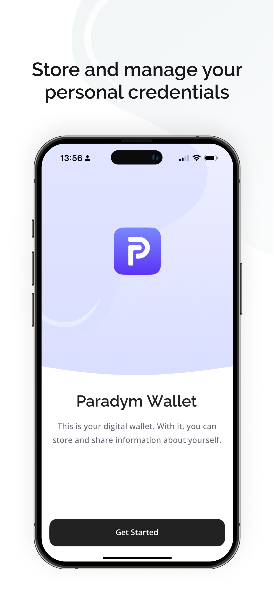
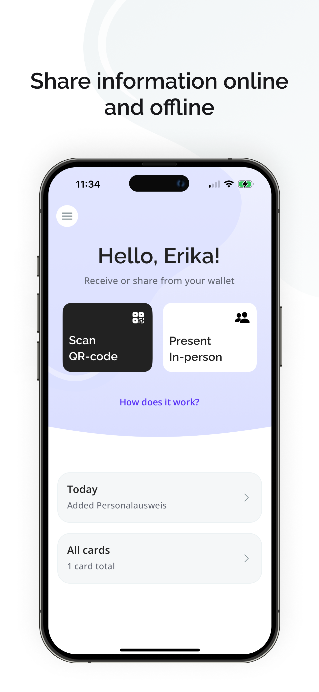
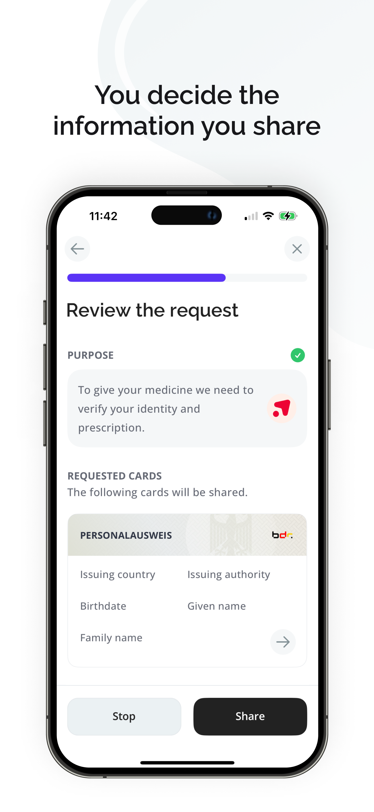
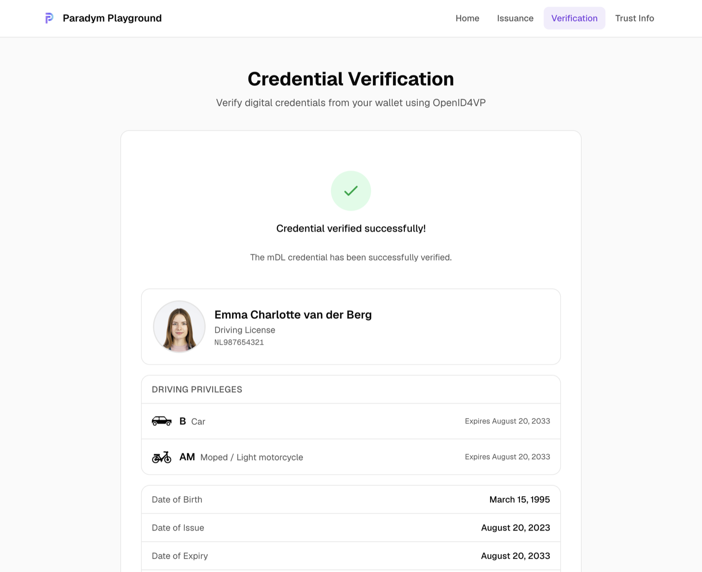
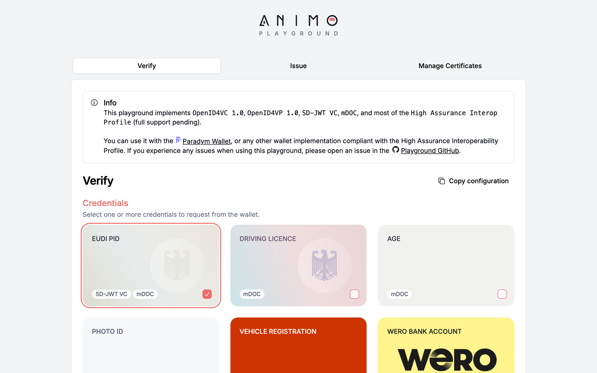

<div align="center">
   
</div>

<h1 align="center"><b>Paradym Wallet</b></h1>

<p align="center">
  An open source digital identity wallet for EUDI and global standards.
</p>

<p align="center">
  <a href="https://apps.apple.com/nl/app/paradym-wallet/id6449846111?l=en">App Store</a>
  &nbsp;|&nbsp;
  <a href="https://play.google.com/store/apps/details?id=id.paradym.wallet">Google Play</a>
  &nbsp;|&nbsp;
  <a href="https://paradym.id/products/paradym-mobile-wallet">Website</a>
  &nbsp;|&nbsp;
  <a href="packages/sdk">Wallet SDK</a>
</p>

<div align="center">
  
  
  
</div>

Paradym Wallet lets people receive, store and share digital credentials such as an ID card, a driving licence or a bank account. Credentials stay on the phone, and the user decides what to share and with whom. You can use the wallet as it is from the app stores, or use this repository as the starting point for your own wallet.

## Features

- **OpenID4VC**: receive credentials with OpenID4VCI and share them with OpenID4VP 1.0, including DCQL, signed requests and deferred and batch issuance.
- **All major credential formats**: SD-JWT VC, mdoc (ISO 18013-5, mDL), W3C Verifiable Credentials and AnonCreds.
- **EUDI ready**: the EU PID, mDL, age verification and photo ID, and relying party registration certificates.
- **Digital Credentials API**: share credentials from the browser on both iOS and Android, over OpenID4VP or ISO 18013-7.
- **In-person sharing**: present an mdoc offline over Bluetooth, started from a QR code or NFC tap.
- **Payments and signing**: confirm payments with strong customer authentication (EUDI SCA and PaSO) and authorize qualified electronic signatures.
- **DIDComm**: connect to issuers and verifiers, and receive and present AnonCreds credentials.
- **Trust**: see who you're dealing with, based on X.509 certificates, DIDs and trusted issuer and verifier lists.
- **Security**: PIN and biometric unlock, encrypted storage and hardware-backed keys in the Secure Enclave or StrongBox.
- **Available in 7 languages**: English, German, Dutch, Finnish, Swedish, Portuguese and Albanian.

The wallet is also available as a [white-label solution](mailto:ana@paradym.id), and the credential and protocol logic is published as the [`@paradym/wallet-sdk`](packages/sdk) package to build your own wallet.

## Issue and verify with Paradym

[Paradym](https://paradym.id) is our platform to issue and verify digital credentials. It integrates with any digital identity wallet, including the EUDI wallets of the member states, and works out of the box with Paradym Wallet. Sign up for free at [paradym.id](https://paradym.id).

## Try it out

Install Paradym Wallet from the [App Store](https://apps.apple.com/nl/app/paradym-wallet/id6449846111?l=en) or [Google Play](https://play.google.com/store/apps/details?id=id.paradym.wallet), then open one of the playgrounds.

### Paradym Playground

The [Paradym Playground](https://playground.paradym.id) is the quickest way to get started. Issue a PID or mDL to your wallet and verify it again in a few clicks, powered by Paradym.

<a href="https://playground.paradym.id"></a>

### Animo Playground

The [Animo Playground](https://playground.animo.id) is our experimental playground, where we try out the latest specifications first. You can configure almost everything: issuers, credential formats, attributes, authorization flows, the Digital Credentials API and your own certificates. Use it for experimentation, and expect things to break now and then. The code is on [GitHub](https://github.com/animo/openid4vc-playground).

<a href="https://playground.animo.id"></a>

## Development

The repository is a pnpm monorepo with an Expo (React Native) app. The UI is built with Tamagui, and [Credo](https://github.com/openwallet-foundation/credo-ts) powers the credential and protocol logic.

- `apps/wallet`: the Paradym Wallet app for iOS and Android
- `packages/sdk`: `@paradym/wallet-sdk`, with the OpenID4VC, DIDComm, Digital Credentials API, proximity and payment flows
- `packages/app`: shared components, hooks and providers
- `packages/ui`: the Tamagui UI kit
- `packages/scanner`: QR code scanning
- `packages/translations`: Lingui setup and translation scripts
- `packages/utils`: shared helpers

### Run the wallet

You need Node.js 22 and pnpm. Install the dependencies, then build and install a development build on a simulator or device:

```sh
pnpm install
cd apps/wallet
pnpm prebuild
pnpm ios # or: pnpm android
```

Then start Metro with `pnpm start` from `apps/wallet`. You only need a new development build when native code changes. For JavaScript changes, Metro is enough.

### Add dependencies

Dependency versions are pinned in the pnpm catalog in `pnpm-workspace.yaml`.

- JavaScript-only dependencies go in the package that uses them.
- Dependencies with native code go in `apps/wallet`. If another package also needs to import it, install the exact same version there, or you'll end up with two copies at runtime.

Run `pnpm install` from the root after any dependency change.

### Release

The [Continuous Deployment](https://github.com/animo/paradym-wallet/actions/workflows/continuous-deployment.yaml) workflow builds the app with EAS. Bump the `version` in `apps/wallet/package.json`, then run the workflow with the `production` channel. The builds are submitted to TestFlight and the Google Play alpha track, and released to users from App Store Connect and the Google Play Console.

SDK changes need a changeset (`pnpm changeset`). Merging the `chore(release): new version` pull request publishes a new version of `@paradym/wallet-sdk`.

## License

Paradym Wallet is licensed under the [Apache 2.0 license](LICENSE).
